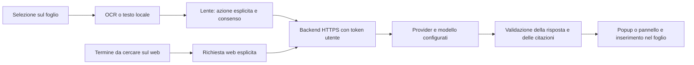

# AI, API e accesso personale — verifica del 21 ottobre 2026

La scelta operativa per NeuralNotes privato è il backend HTTPS già implementato, con modello configurabile e chiave del provider sul server. Nell’app restano disponibili anche le connessioni API personali tramite portachiavi. L’attivazione live richiede endpoint e credenziali reali; i test qui usano fixture e non consumano API.

## Percorso delle richieste



| Percorso | Dati inviati | Risultato |
| --- | --- | --- |
| `/v1/study` | Domanda e fino a 40 estratti salvati | Riassunto, schema, chat, confronto e altre elaborazioni con riferimenti a pagina/minuto. Streaming opzionale. |
| `/v1/lookup` | Termine e fonti selezionate | Scheda strutturata dalle fonti del quaderno: definizione, spiegazione, esempi, termini correlati. |
| `/v1/quiz` | Estratti e numero massimo di domande | Quiz strutturato; risposte, cronometro e progressi restano sul dispositivo. |
| `/v1/research` | **Soltanto il termine**, massimo 120 unità UTF-16 | Ricerca web con annotazioni URL restituite dal provider, citazioni cliccabili e possibilità di inserire la risposta con collegamenti. |

La ricerca web usa il tool Responses `web_search`, richiede una ricerca effettiva e ha `max_tool_calls: 1`. Rifiuta risposte incomplete, prive di una ricerca completata o senza citazioni valide. Le citazioni provengono dalle annotazioni del provider; non si estraggono URL inventati dal testo libero. I marcatori sono cliccabili accanto al testo e le fonti sono conservate anche nell’inserimento. Questo verifica il contratto, non l’esattezza di ogni affermazione. [OpenAI Docs: ricerca web](https://developers.openai.com/api/docs/guides/tools-web-search), [limite delle chiamate ai tool](https://developers.openai.com/api/reference/resources/responses/methods/create).

La trascrizione usa Apple Speech sul dispositivo a finestre; audio e PDF binari non vengono inviati a questi endpoint. Il percorso web non riceve il resto della pagina o della registrazione.

## Configurazione economica

Un candidato verificato è `gpt-6-luna`: supporta Responses, streaming, output strutturati e ricerca web. Il listino Standard consultato indica $0,10 per milione di token in ingresso e $0,50 in uscita. L’audio non è un suo input supportato. [Modello e prezzi ufficiali](https://developers.openai.com/api/docs/models/gpt-6-luna).

Esempio aritmetico: 20.000 token in ingresso e 1.500 token fatturati in uscita costerebbero $0,00275 alle tariffe Standard indicate. Sono esclusi tool web, cache, sovrapprezzi regionali e altre condizioni. Non è una misura delle richieste dell’app o una previsione di spesa mensile. I token di ragionamento consumano anch’essi il budget di uscita del modello.

Configurazione di esempio, da impostare nell’ambiente del server insieme ai segreti descritti nel README del backend:

```text
NN_MODEL=gpt-6-luna
NN_REASONING_EFFORT=low
NN_MAX_OUTPUT_TOKENS=4096
NN_ENABLE_WEB_SEARCH=1
```

Il codice non seleziona automaticamente un modello a pagamento. `NN_REASONING_EFFORT` è facoltativo: se assente non viene inviato; se configurato deve essere supportato dal modello. `NN_ENABLE_WEB_SEARCH` è disattivato inizialmente e abilita la ricerca soltanto con valore `1`. L’app richiede comunque il consenso della connessione e un comando esplicito. Un budget di uscita troppo piccolo può produrre una risposta incompleta, segnalata come errore anziché salvata come risposta riuscita.

Il backend applica autenticazione, quote per utente, timeout, limite di concorrenza e dimensione. Le quote attuali sono in memoria e si azzerano al riavvio: per un servizio pubblico servono quote persistenti e controllo della spesa del provider. Latenza, qualità e costo effettivo del modello non sono stati misurati con chiamate live.

## Login con ChatGPT

OpenAI distingue l’identità dell’utente dall’autorizzazione a utilizzare il piano ChatGPT per richieste AI. Un semplice login non concede automaticamente accesso alle API o alle conversazioni. La disponibilità documentata comprende partner commerciali selezionati, partner open source e alcuni client privati; questa app non ha ancora una registrazione/abilitazione confermata. [Disponibilità e ambiti ufficiali](https://developers.openai.com/siwc/quickstart).

Il flusso open source documentato usa callback HTTP su `127.0.0.1`, PKCE, verifica di stato/nonce e validazione del token con JWKS. Restituisce un client ID emesso per la registrazione, da conservare insieme all’identità verificata. La sua integrazione nell’app iPad richiede la verifica del tipo di client e della callback autorizzata. [Registrazione e accesso ufficiali](https://developers.openai.com/siwc/token-sharing-open-source/sign-in).

Stato attuale: connessioni tramite chiave personale o token del backend implementate; login ChatGPT e login consumer di altri servizi non configurati. La documentazione di un flusso OAuth non prova l’abilitazione dell’account o dell’app. Le sessioni web del consumatore non vengono riutilizzate come chiavi API.

## Percorsi della Lente

- Testo digitato: selezione nativa → Apri nella Lente AI. Usa esattamente il testo selezionato.
- Grafia, immagini o PDF: strumento Lente → tocco, area o sottolineatura. La sottolineatura seleziona il testo superiore e non altera un normale tratto di penna.
- Lazo/oggetti: selezione → Chiedi alla Lente AI. OCR sul ritaglio quando necessario.
- Popup rapido: spiegazione/definizione/esempio sulle fonti, oppure scheda del termine e ricerca web. Espandibile nel pannello laterale.
- Integrazione: risposta inserita come testo formattato modificabile; per il web conserva i collegamenti e l’azione è annullabile.

Durante una nuova lettura le vecchie fonti vengono svuotate e l’invio è disabilitato. Se la pagina cambia, compare Aggiorna le fonti. La richiesta conserva una copia della selezione e delle impostazioni con cui è partita. La qualità OCR della sottolineatura, il popup e i collegamenti nell’editor richiedono ancora prova Apple/fisica.

La cache della ricerca scade dopo un’ora e distingue termine, motore, modello e destinazione. Il timestamp resta visibile; un risultato riutilizzato non viene presentato come una nuova ricerca. Il salvataggio avviene dopo aver mostrato la risposta validata: un problema di spazio o persistenza è segnalato separatamente senza nascondere il testo ricevuto.
