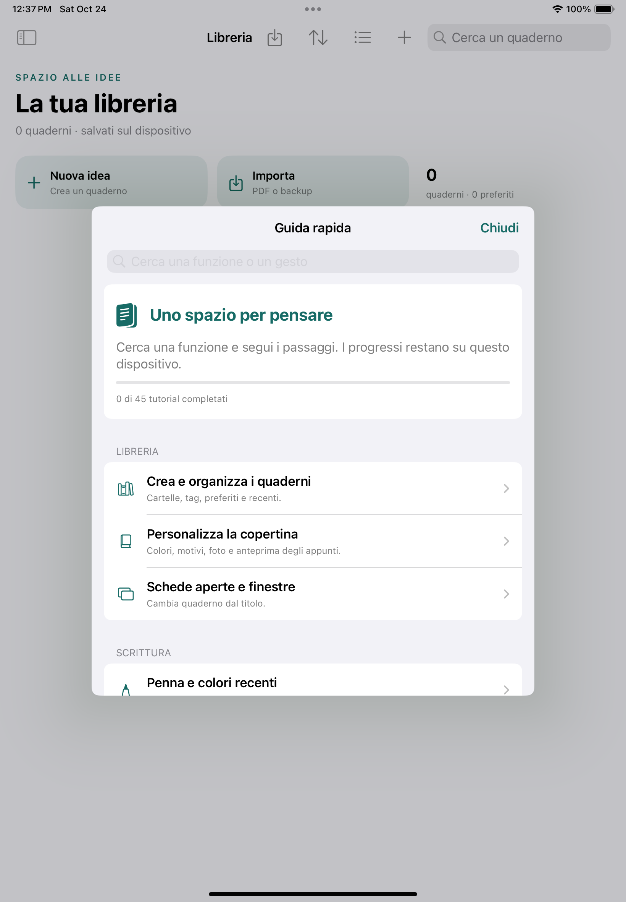

# NeuralNotes 0.23.0 / build 50 — candidato delivery

## Annulla

Le modifiche della pagina corrente (inchiostro, testo, immagini e oggetti) vengono ripristinate dalla cronologia in memoria. Questo percorso non attende un salvataggio, non rilegge tutte le intestazioni delle pagine e non scrive due revisioni per mostrare il risultato. Il salvataggio segue tramite la normale coda; navigazione e chiusura continuano ad attendere la persistenza.

Una scrittura su disco già avviata aggiorna solo revisione e riferimenti ai file della pagina attuale: non rimette il suo vecchio contenuto nel canvas. Se nel frattempo viene annullato un tratto e scritto un nuovo tratto, il ciclo salva anche l’ultimo stato. Il fallimento del disco conserva il contenuto e la cronologia in memoria con errore e possibilità di ritentare.

Rimangono le protezioni PencilKit contro i callback tardivi e la ricomparsa del tratto annullato. Un tratto appena concluso ma non ancora consegnato da PencilKit può richiedere una breve attesa; le azioni strutturali fra pagine richiedono ancora I/O. Non si promette una latenza fisica costante su qualsiasi dimensione di disegno.

## Account e sincronizzazione

- Accesso email, rinnovo sessione, profilo, esportazione dati e cancellazione verificata restano disponibili quando il servizio è configurato.
- Sincronizzazione bidirezionale dei quaderni chiusi, con identità mantenuta, coda persistente e ripresa dei trasferimenti interrotti.
- Checkpoint distinti fra impronta dei file locali e revisione remota; confronto a tre vie e scelta esplicita per i conflitti.
- Download con verifica di dimensione, SHA-256 e pacchetto; prima dell’installazione viene verificato che il quaderno locale non sia cambiato e viene conservato un backup.
- Controllo automatico ogni due minuti mentre l’app è attiva, attivabile separatamente per account e origine del servizio. Il cambio account non eredita l’attivazione di un altro utente. Il percorso automatico non include quaderni locali sconosciuti a quell’account; per associarne di nuovi usare il comando esplicito «Sincronizza adesso».
- Catalogo remoto paginato oltre i primi 50 quaderni. Il backup manuale dopo una ricezione usa la revisione acquisita dalla sincronizzazione.
- Limite account di **100 MiB per quaderno**. Cartelle e cestino rimangono locali; nessuna eliminazione è propagata. Il limite di importazione PDF locale è distinto.

L’account locale dell’app e quello Apple sono separati. La libreria sul dispositivo non viene eliminata al logout: non è un contenitore cifrato separato per ciascun utente NeuralNotes. Su dispositivi condivisi gli appunti locali restano accessibili nell’app.

## Guida

La guida contiene **45 tutorial** suddivisi in sei aree, ricercabili per testo e gesti. Ogni tutorial offre tre passaggi, navigazione Avanti/Indietro, riepilogo completo e completamento persistente sul dispositivo. Copre tutti gli strumenti selezionabili del workspace, oltre a libreria, PDF, audio, studio, account e protezione. I requisiti dei servizi remoti sono indicati nelle relative istruzioni.

La [guida esportata](GUIDA_FUNZIONI.md) deriva dallo stesso catalogo dell’app; rigenerarla con `python tools/export_feature_guide.py`.



## Verifiche

Sorgenti app finali: `9479101f808f719f2c91cccdb17fd708b8df828f`.

[Verifica finale Apple e ZIP](https://github.com/sminikiller/NeuralNotes/actions/runs/40094066536), [compatibilità finale Swift 5.10 / Xcode 15.4](https://github.com/sminikiller/NeuralNotes/actions/runs/40094070538). [Suite completa precedente, servizi locali e aggiornamento](https://github.com/sminikiller/NeuralNotes/actions/runs/40091191725), su `8f0eff2`.

| Prova | Esito |
| --- | --- |
| Progetto, sintassi, pacchetto e backend unit | PASS: grammatica di 310 file Swift, struttura, risorse e 53 test Node. |
| Core macOS | PASS: 275 XCTest e 98 FSRS sulla revisione finale. |
| Servizi reali locali | PASS: email OTP, due utenti, profilo, refresh/logout, quote, RLS, Storage privato, upload/download identico, CAS e cancellazione riprendibile. Provider AI simulato. |
| Aggiornamento | PASS: installazione del nuovo binario sopra 0.20.8 su iPad Simulator; quaderno SwiftData, manifest/catalogo e trascrizione di controllo conservati. |
| ZIP / Xcode 16.4 | PASS: Release simulatore e dispositivo senza firma; app dello ZIP installata, avviata e viva per 60 iterazioni, libreria/guida riconosciuta tramite OCR. |
| ZIP / Xcode 15.4 | PASS: Swift 5.10, Release simulatore e dispositivo senza firma; contenuto di tutti i file identico al pacchetto Xcode 16.4. |
| Nativi finali | 99 casi eseguiti: 98 passati e un controllo temporale del backup ripetuto con successo nel seguito descritto sotto, con sorgenti app identici. Account/sync, Annulla, contenuti e audio passati. |
| UI finali | PASS: sette test, inclusi pixel del tratto/Annulla/nuova scrittura, testo, proporzioni del canvas, cursore/salto/stato, schede, accesso account e guida con completamento persistente. |
| Release del progetto iOS | PASS: compilazione senza firma. |

Archivio da consegnare: `NeuralNotes-iPad-0.23.0.zip`, **524.940 byte, 232 file**. Copiato senza rigenerarlo dall’artefatto finale `9479101` compilato e avviato dalla CI Xcode 16.4. SHA-256:

```text
1a3b1df7a09ab8618bbace9f99ca3e84a2c7d02f623426a2728481eaae953971
```

Contenuti confrontati con i sorgenti canonici e controllo CRC passato. Il confronto Windows/macOS normalizza soltanto CRLF/LF dei file testuali; le risorse binarie devono coincidere esattamente. Il diverso SHA del contenitore ZIP compilato con Xcode 15.4 deriva dai metadati di archivio, non da differenze nei file estratti.

Il primo passaggio `4e4870b` non è dichiarato verde: la Release del progetto e 274 XCTest Core più 98 FSRS sono passati, ma il nuovo test account chiamava un inizializzatore non pubblico. Corretto il test usando il decoder pubblico. Gli altri job di quel passaggio sono stati annullati per eseguire la revisione finale.

La suite completa su `8f0eff2` ha eseguito 275 Core e 98 FSRS su macOS; nell’host iOS, 413 XCTest (409 passati, due saltati per i controlli Darwin `/private/var` già eseguiti su macOS, due falliti nelle nuove fixture cloud), 98 FSRS e 28 UI (27 passati, uno fallito nel nuovo test guida). Non viene dichiarata verde. Le fixture cloud ora creano la prima pagina prima di scrivere; il test guida seleziona il campo di ricerca della guida invece di quello della libreria dietro la finestra. I percorsi corretti sono poi passati su `a2c0ab3` nella [ripetizione mirata](https://github.com/sminikiller/NeuralNotes/actions/runs/40093787948). Le [evidenze della suite completa](https://github.com/sminikiller/NeuralNotes/actions/runs/40093682092) sono conservate.

Il passaggio finale `9479101` aggiunge il collegamento del toggle al percorso automatico conservativo: anche attivarlo non associa quaderni sconosciuti all’account. Ripete tutte le sei classi native selezionate e i sette UI. Le altre classi della suite completa precedente non sono dichiarate rieseguite sulla revisione finale.

La run finale `40094066536` non viene presentata come una pipeline interamente verde: un solo caso nativo, `testMaintenanceWaitsForIdleAndDoesNotStartFromCleanFlushOrClose`, non ha visto il backup entro i due secondi del ciclo di polling (due assert falliti nello stesso caso). Lo stesso caso era passato sulla ripetizione `a2c0ab3`. Il controllo riguarda lavoro in inattività, che include prima l’indicizzazione, e non la latenza interattiva di Annulla. Ora attende il backup effettivamente committato con un limite esplicito di dieci secondi, mantenendo i controlli che un flush pulito e la chiusura non avviino copie extra.

Il [seguito nativo `40095393930`](https://github.com/sminikiller/NeuralNotes/actions/runs/40095393930), `843b52c`, è **PASS**: quel controllo (0,707 s per l’intero caso) e due regressioni di Annulla con writer sospeso/errore, tre test passati, nessun fallimento. Prima di eseguirli la CI impone `git diff --exit-code` su tutti i sorgenti dell’app, progetto, manifest e generatori rispetto a `9479101`: il codice e lo ZIP della consegna non sono cambiati per ottenere il risultato. Core, UI e Release non vengono conteggiati nuovamente in questo seguito. Le [evidenze finali](https://github.com/sminikiller/NeuralNotes/actions/runs/40095259679) conservano anche il singolo fallimento iniziale, oltre ai sette UI passati.

La [schermata dopo il completamento e il riavvio](images/guide-progress-0.23.png) mostra il progresso 1/45 conservato dal test UI. Non rimangono fallimenti irrisolti nei percorsi eseguiti; i gate fisici e di pubblicazione restano separati sotto.

Le regressioni di Annulla verificano assenza di I/O nel percorso immediato, budget di 150 ms su un disegno sintetico con writer bloccato, nuove modifiche durante una scrittura precedente, errore del disco e ritentativo, sequenza rapida di Annulla/Ripristina e mancata ricomparsa dei tratti mediante confronto dei pixel del canvas. Il budget del test non è una misura dell’iPad fisico.

## Gate che restano esterni alla build

Questa è una consegna candidata, **non un servizio pubblico o una pubblicazione App Store completata**. Nella sessione non risultano collegamenti attivi a Supabase/Render, variabili di hosting/provider, segreti GitHub o un gateway pubblico configurato nei plist. L’accesso gestito resta quindi disabilitato con spiegazione nell’app; non è stato inserito un host di esempio. Il backend e i contratti sono testabili localmente, come descritto in [ACTIVATION.md](../backend/ACTIVATION.md).

Restano pubblicazione di Auth/database/Storage/gateway, SMTP di produzione e prova reale del provider AI. Per iCloud servono build firmata, entitlement e contenitore CloudKit attivi. Il Team ID da solo e un certificato pubblico `.cer` non permettono di firmare una delivery: mancano la chiave privata e il provisioning utilizzabili in questa sessione.

Registrazione fisica di più ore, standby, fotocamera/scanner, prestazioni di grandi documenti e conservazione della libreria nel contenitore Playgrounds dell’iPad richiedono ancora il dispositivo. Le prove sintetiche e il simulatore non vengono dichiarati equivalenti.
