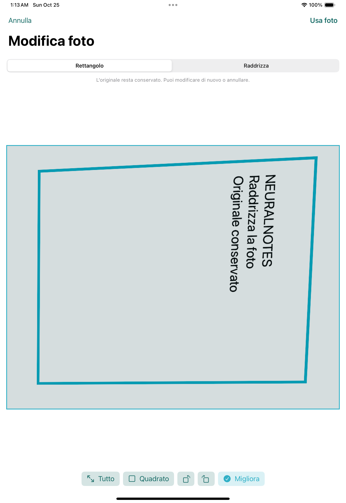

# NeuralNotes 0.24.0 / build 51 — foto e centro sincronizzazione

## Raddrizzamento non distruttivo

- Quattro vertici normalizzati con origine in alto a sinistra, ordinamento, controllo di convessità e dimensioni ricavate dalla media dei lati opposti. Il validatore rifiuta coordinate non finite, fuori immagine, quadrilateri degeneri o incrociati.
- `ImageElement` conserva prospettiva, rotazioni di un quarto di giro e miglioramento come metadati facoltativi. Le immagini dei vecchi quaderni continuano a decodificarsi. Nessuna migrazione della libreria SwiftData.
- Il pannello foto offre Rettangolo e Raddrizza, quattro maniglie da 44 punti, ingrandimento durante il trascinamento, rilevamento con Vision e alternativa rettangoli, rotazioni e contrasto/nitidezza. Il rilevamento automatico parte entrando in Raddrizza senza una correzione già impostata. Un risultato tardivo non sostituisce angoli modificati manualmente.
- L’ordine è: orientamento EXIF, prospettiva, rotazione, miglioramento, crop. La modifica della prospettiva o della rotazione azzera il crop, perché cambia il riferimento del ritaglio.
- Le maniglie aggiornano solo il contorno; il filtro di anteprima viene calcolato fuori dal main actor. Il rendering finale è condiviso da canvas, immagini esportate, PDF e Lente. La cache distingue tutte le correzioni.
- Camera, Foto e importazione di un’immagine passano dal pannello. Raddrizza è disponibile anche dalla selezione e dal menu contestuale delle immagini. Foto e chiedi applica le stesse correzioni all’immagine inviata all’AI e le conserva se la foto viene inserita nel quaderno.
- L’asset di base conservato all’importazione resta intatto; confermare modifica unicamente i metadati della pagina con la normale cronologia annulla/ripristina. Un’app precedente può ignorare questi nuovi metadati e mostrare l’immagine senza correzione.

## Account e centro sincronizzazione

- Un unico pulsante Account e servizi nella barra della libreria riunisce accesso, cloud NeuralNotes, iCloud e motore AI, con il rispettivo stato.
- Il centro mostra account, data dell’ultimo backup confermato, coda e conflitti senza contarli due volte.
- Backup alla chiusura facoltativo e distinto dalla sincronizzazione bidirezionale periodica. Si applica ai quaderni esplicitamente collegati all’account con Sincronizza adesso; non include automaticamente quaderni di un altro utente presenti nella libreria locale condivisa. I quaderni invariati non generano un’altra versione.
- La preferenza Solo Wi-Fi usa `NWPathMonitor`: Wi-Fi disponibile, connessione non costosa e non limitata. La copia preparata resta nella coda persistente; al ritorno della rete o al successivo controllo nell’app riprende l’invio. Le sessioni automatiche vietano anche traffico cellulare, costoso o limitato. I comandi manuali possono usare la rete disponibile.
- La preparazione attende il rilascio del quaderno da parte dell’editor e usa la coda esistente. Le chiusure durante un’altra operazione vengono serializzate. Non è un servizio di upload garantito dopo la terminazione dell’app da parte di iPadOS.
- Badge sulle copertine e nell’elenco: copia nel cloud con data, in coda, conflitto, solo sull’iPad. Se l’account è connesso ma l’indice non è stato verificato, il badge lo indica senza dichiarare il quaderno solo locale.
- Versioni cloud paginate con revisione, data e dimensioni. Scarica questa versione come copia verifica dimensioni e SHA-256 e importa con identità nuove, senza sostituire il quaderno corrente.
- Le preferenze e la coda rimangono separate per utente e servizio. Il logout non cancella né separa fisicamente i quaderni locali.

## Backend

- `GET /v1/platform/snapshots?document=<UUID>&offset=<n>`: 50 revisioni per pagina, dalla più recente, filtrate sul proprietario autenticato. I percorsi Storage non vengono esposti nell’elenco.
- `GET /v1/platform/download?document=<UUID>&revision=<n>`: URL firmato per una singola revisione, valido 60 secondi. RLS, filtro esplicito sul proprietario e verifica del percorso precedono la firma. Il download della versione attuale e quello dei materiali community restano compatibili.
- Nessuna nuova migrazione SQL: `nn_snapshots`, gli oggetti immutabili e le policy del proprietario esistono già. Il gateway deve essere aggiornato per esporre i due percorsi.
- Il codice predisposto non attiva un hosting pubblico né abilita automaticamente CloudKit: occorrono ancora servizio pubblicato e credenziali/configurazione di distribuzione già descritte in `backend/ACTIVATION.md`.

## Verifica

La [verifica completa Apple 40111820267](https://github.com/sminikiller/NeuralNotes/actions/runs/40111820267), sul sorgente `cbfcc2b434d0ab77264bec79ec725041cc0dc0fc`, è passata in tutti e cinque i job:

- 55 test unitari Node e controllo grammaticale di 321 file Swift.
- macOS: 280 XCTest Core e 98 test FSRS, senza errori.
- Simulatore iPadOS 18.5: 423 XCTest Core/nativi, dei quali 421 passati e due saltati perché specifici degli alias Darwin `/private/var`; entrambi passano nel job macOS. Anche 98 test FSRS sul simulatore passano.
- Tutti i 29 test dell’interfaccia passano. Il test foto trascina un angolo, ruota, attiva Migliora, conferma e riapre, verificando che le impostazioni siano conservate. Il test account apre il nuovo centro e arriva al campo email. Gli altri test coprono anche l’editor, Annulla, navigazione, audio e guida.
- Riepilogo xcresult: **548 passati, due saltati, zero fallimenti** su 550 test del simulatore.
- Build Release del progetto Xcode e del pacchetto App Playground effettivamente estratto dallo ZIP, per simulatore e dispositivo senza firma. Il pacchetto è installato e avviato sul simulatore; processo vivo per 60 controlli e libreria/guida rilevate a schermo.
- Backend con servizi locali reali: Auth email, PostgreSQL/RLS, Storage, quote, commit con controllo revisione, storico proprietario, URL firmato di una revisione con confronto dei byte, isolamento fra account, rinnovo/uscita e cancellazione. Il provider AI in questo collaudo è esplicitamente simulato: non sono state eseguite richieste a un provider live.
- Aggiornamento simulato da 0.20.8 alla nuova app, installata sullo stesso contenitore senza disinstallazione: quaderno SwiftData, manifest e catalogo con trascrizione conservati; gli hash dei file controllati sono identici prima e dopo.

La revisione finale `0048cb19f21ee28255652a2e4bbcdae228071d1c` corregge anche la codifica di alcune stringhe individuata nell’ispezione della schermata e mantiene le proporzioni di una foto già ruotata prima del raddrizzamento (regressione aggiunta al test di annulla/export). L’anteprima cattura una copia immutabile delle impostazioni per compilare anche con Swift 5.10.

La [verifica finale mirata 40148822439](https://github.com/sminikiller/NeuralNotes/actions/runs/40148822439) è **PASS** sulla revisione consegnata: 280 XCTest Core e 98 FSRS su macOS, tutti i 104 test nativi selezionati (editor, affidabilità, audio, account e foto), tre prove UI (foto, accesso dal centro account e apertura/chiusura Lente), Release del progetto e dello ZIP reale per simulatore e dispositivo senza firma. Lo ZIP è stato installato e avviato sul simulatore, rimasto vivo per 60 controlli con libreria/guida rilevata a schermo. I job backend e upgrade non sono ripetuti nel seguito: la logica backend è invariata rispetto alla verifica completa verde.

La [compilazione aggiuntiva Xcode 15.4 / Swift 5.10](https://github.com/sminikiller/NeuralNotes/actions/runs/40148826004) sulla stessa revisione finale è **PASS**: build Release dello ZIP reale, sia per simulatore sia per dispositivo senza firma. Il primo tentativo ha individuato una cattura mutabile nell’anteprima, ora sostituita con una cattura per valore. Non si tratta di esecuzione fisica su iPad.

L’[estrazione finale di xcresult e schermate](https://github.com/sminikiller/NeuralNotes/actions/runs/40150081546) conferma **107 test passati, zero saltati e zero fallimenti** nel seguito nativo/UI. La schermata è stata ispezionata anche visivamente, verificando la correzione dei caratteri accentati:



Non sono prove fisiche su iPad: fotocamera, Apple Pencil, precisione del rilevamento su foto reali e iCloud firmato richiedono ancora il collaudo sul dispositivo. I controlli di sintassi su Windows non sostituiscono il type-checking Apple.

## Pacchetto iPad

`NeuralNotes-iPad-0.24.0.zip`: 538.822 byte, 239 file. Artefatto della compilazione Apple finale, non rigenerato dopo il collaudo. SHA-256:

```
7a0b2d8230ed9f00c5e609260f4ef8ea5f8b61c5d8a9c7ee0a42cbc189bb0f4f
```

CRC e insieme completo dei file verificati; confronto con i sorgenti canonici passato (solo normalizzazione CRLF/LF per 112 file testuali, risorse binarie identiche). Il pacchetto compilato anche con Swift 5.10 contiene gli stessi file estratti, byte per byte; il differente hash ZIP dipende dai metadati dell’archivio.

Esportare prima un backup nativo dei quaderni attuali, estrarre lo ZIP e aprire `NeuralNotes.swiftpm` in Swift Playgrounds. Il pacchetto non richiede l’uso di xtool o di WSL. Conservare il progetto e i backup precedenti durante il collaudo sull’iPad.
