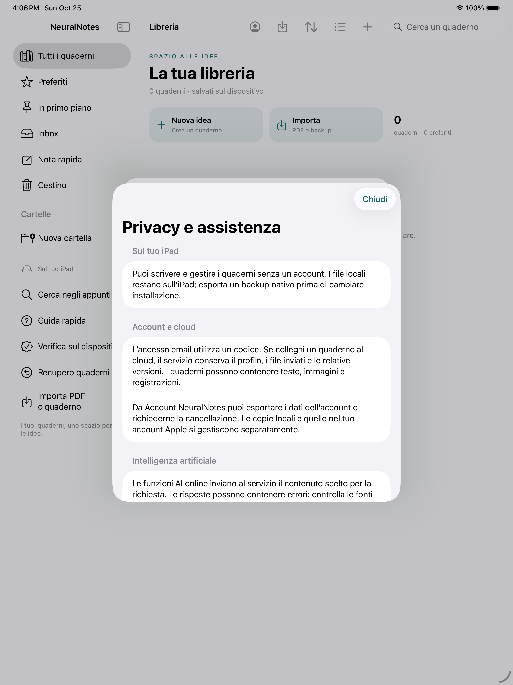

# NeuralNotes 0.24.1 / build 52 — preparazione della distribuzione

Sorgente dell’app e degli strumenti collaudati: `96d17ae01b230523d6a7a58192ce981aab87aaa0`. Verifiche del 25 ottobre 2026. Non è una pubblicazione su TestFlight/App Store.

## Modifiche

- Scope delivery nella CI: Xcode 26.6 su macOS 26, test, pacchetto Playground Release, avvio reale nel simulatore e archivio per dispositivo. Conservata la verifica con il compilatore precedente.
- Archivio candidato Store con versione 1.0.0 e build CI; firma Apple Distribution e upload predisposti, separati dalla normale verifica senza firma. Un upload richiede servizi e pagine pubbliche configurati, accettazione della revisione esatta e credenziali private nel gestore segreti.
- Controllo di profilo App Store Connect: team, App ID, scadenza, certificato presente e container CloudKit Production. Il percorso di firma usa un keychain temporaneo, con pulizia di chiavi/profili anche dopo errore. La firma vera non è stata eseguita in assenza delle credenziali.
- Nuova voce Privacy e assistenza in Account e servizi. Le URL pubbliche vengono mostrate quando configurate; nessun indirizzo fittizio viene presentato come informativa. Il login spiega anche l’invio dei quaderni al cloud e nasconde la configurazione tecnica del servizio quando l’URL è già incluso nell’app.
- Manifest privacy aggiornato per i dati di account/cloud facoltativi e per le API richieste dal codice: preferenze, metadati dei file locali/scelti dall’utente, controllo dello spazio prima delle scritture e misurazione dei tempi interni.
- Le nuove registrazioni non salvano più l’uptime del dispositivo nel campo legacy `hostStart`, non usato per riproduzione o ancore. Le registrazioni precedenti rimangono decodificabili; `start`/`duration` non cambiano.
- Script di configurazione esteso alle pagine privacy e assistenza, verificate prima della modifica dei plist. Cinque regressioni del controllo di distribuzione, incluso il rifiuto di SDK obsoleti o motivazioni API mancanti.
- Metadati italiani per lo Store, schema CloudKit, flussi privacy e istruzioni di migrazione raccolti in [release/DELIVERY.md](../release/DELIVERY.md).

## Verifiche Apple

La [suite completa sul nuovo SDK](https://github.com/sminikiller/NeuralNotes/actions/runs/40205492836), sul sorgente precedente `909a947`, ha eseguito:

- macOS: 280 XCTest Core e 98 FSRS passati.
- Simulatore iPadOS 26.4.1 / iPad Pro 13-inch M5: 423 XCTest nativi/Core, 421 passati e due saltati per gli alias Darwin `/private/var`; anche 98 FSRS passati. I due casi saltati passano nel job macOS.
- 30 test UI: 29 passati, uno fallito sul pinch sintetizzato da XCTest. Il riepilogo complessivo era 548 passati, due saltati, un fallimento su 551: non viene presentato come suite verde.
- Backend reale locale, aggiornamento senza disinstallazione e ZIP Release compilato/avviato passati.

L’evento sintetizzato del pinch fallito spostava ciascun dito meno di dieci punti; sul nuovo simulatore non superava la soglia di riconoscimento del gesto. Il test ora usa una divaricazione più ampia, mantenendo tutte le verifiche su zoom, doppio tocco, larghezza e Pagina intera. Il [seguito mirato](https://github.com/sminikiller/NeuralNotes/actions/runs/40208289402) passa sugli stessi sorgenti dell’app, con controllo di uguaglianza imposto dalla CI. Il codice dello zoom non è stato modificato per far passare il test.

La [verifica finale sul sorgente consegnato](https://github.com/sminikiller/NeuralNotes/actions/runs/40209152163) è **PASS**:

- 280 XCTest Core e 98 FSRS macOS.
- Tutti i 104 test nativi selezionati: editor/affidabilità/contenuti, account, audio, trascrizione/compressione e foto.
- Tutte le tre UI selezionate: pinch/doppio tocco/Pagina intera, privacy senza account e accesso email dal centro servizi.
- [Riepilogo xcresult estratto con il tool dello stesso Xcode](https://github.com/sminikiller/NeuralNotes/actions/runs/40210621729): **107 passati, zero saltati, zero fallimenti** nel seguito nativo/UI.
- Build Release per dispositivo senza firma. Lo ZIP effettivo è stato estratto e compilato con il proprio manifest per simulatore e dispositivo, installato e avviato: processo vivo per 60 controlli e libreria/guida rilevata a schermo.
- Cinque controlli Python della distribuzione e 55 test Node, senza chiamate al provider.

La [compilazione aggiuntiva Xcode 15.4 / Swift 5.10](https://github.com/sminikiller/NeuralNotes/actions/runs/40209156663) passa sullo stesso sorgente per simulatore e dispositivo senza firma. I file estratti dei due ZIP sono identici, byte per byte.

La prima compilazione dei test con Swift 6.3.3 aveva individuato un’espressione `CGPoint` troppo complessa nella fixture dello scarabocchio: sostituita con un ciclo tipizzato equivalente; la prova nativa passa. Non è rimasta esclusa dal seguito.

## Audio lungo e conservazione dei dati

La prova nativa `testSixHourFilePipelineResumesAfterCancellationAndKeepsCorrections` passa anche sul sorgente finale. Usa un WAV sparso con intestazione reale di sei ore e lettura dell’ultima finestra; simula il riconoscitore, interrompe dopo 120 blocchi, riprende i 360 restanti e controlla titolo, correzioni, 480 blocchi finali ed export fino a 05:59. Il valore legacy dell’orologio nella fixture è diverso da zero, per verificare che i tempi dipendano solo dalla timeline della sessione.

Non equivale a sei ore di registrazione con microfono, standby o riconoscimento vocale reale. Queste prove restano da fare sul dispositivo fisico.

L’aggiornamento simulato 0.20.8 → nuova app con lo stesso Bundle ID conserva quaderno, manifest e catalogo con trascrizione; gli hash verificati prima/dopo coincidono. Il passaggio dal runner Playgrounds alla nuova app TestFlight può invece usare due contenitori diversi: richiede **esportazione/importazione nativa**, come spiegato nella guida. Non eliminare la copia precedente prima della verifica dei contenuti importati.

## Archivio Store

L’[archivio finale](https://github.com/sminikiller/NeuralNotes/actions/runs/40209182333) è **PASS**:

| Campo | Risultato |
| --- | --- |
| Bundle ID | `com.neuralnotes.NeuralNotes` |
| Versione / build | `1.0.0` / `114` |
| SDK | `iphoneos26.5`, Xcode 26.6 |
| Sistema minimo | iPadOS 17.0 |
| Manifest API | Quattro categorie richieste verificate nell’app archiviata |
| Firma | Assente |
| Upload Apple | Non eseguito |

Il controllo verifica eseguibile, icona/catalogo, privacy manifest, SDK e metadati. Non sostituisce la convalida Apple del binario firmato o App Review. Non è stato prodotto un IPA distribuibile.

## Backend e accessi ancora necessari

Auth email, PostgreSQL/RLS e Storage sono stati collaudati realmente in locale con due account. Il provider AI rimane una fixture in quel collaudo; modello e contratto HTTP DeepSeek sono stati confrontati con la documentazione ufficiale, senza una chiamata live.

Il preflight pubblico resta correttamente bloccato: mancano `NN_SUPABASE_URL`, `NN_SUPABASE_PUBLIC_KEY`, `NN_PROVIDER_KEY`; i connettori hosting/database non sono collegati e il repository non contiene segreti di distribuzione Apple. Mancano anche le pagine pubbliche definitive con operatore/contatto e l’accettazione fisica. Questi dati non sono stati inventati né sostituiti con servizi di esempio.

Restano da attivare e verificare backend HTTPS, SMTP, provider AI, account/cloud reali, firma Apple e CloudKit Production. Nessun servizio pubblico o abbonamento è stato attivato. La community e i pagamenti restano esclusi dalla prima delivery. I limiti della sincronizzazione account (100 MiB per quaderno, cartelle/cestino locali) sono dichiarati nel percorso operativo.

## ZIP per iPad

`NeuralNotes-iPad-0.24.1.zip`: **539.907 byte, 239 file**. È l’artefatto esatto della verifica finale, non un archivio rigenerato dopo il collaudo. SHA-256:

```
16cfe31d30d2753a4e88a3fbeb4a8af573d16b83b7bdf583ead03653cc46a07b
```

CRC, insieme completo dei file e corrispondenza con i sorgenti passati: solo normalizzazione CRLF/LF su 112 file testuali; risorse binarie identiche. Il precedente ZIP 0.24.0 è stato conservato intatto.

Estrarre lo ZIP e aprire `NeuralNotes.swiftpm` in Playgrounds per il collaudo locale. È un progetto sorgente, non l’installazione TestFlight. I passaggi successivi sono in [delivery](../release/DELIVERY.md).


